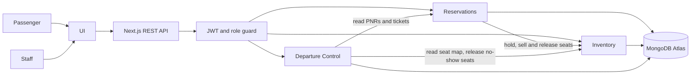

# Airline Passenger Service System (PSS)

A small but complete Passenger Service System for a single airline: a REST API plus a minimal web UI that
takes a passenger from **searching a flight** to **boarding the aircraft**.

| Module | What it does |
| --- | --- |
| **Reservations (ARS)** | Aircraft, flight schedules, fares, search, PNRs (booking records), simulated payment and ticket issuance / voiding. |
| **Inventory (AIS)** | Fare-class buckets per flight cabin, atomic seat holds and sales (no overselling), hold expiry, and a revenue-management rules engine with manual overrides. |
| **Departure Control (DCS)** | Online and airport check-in, seat map, boarding passes (IATA BCBP-style barcode), baggage tags and tracking, load control (weight and balance), and gate boarding through to departure. |

## Architecture



Route handlers under `src/app/api` stay thin: they authenticate (`withAuth`), validate with zod and call a
service in `src/modules/<module>/`. The services own the business rules and talk to MongoDB through Mongoose.

## Stack

- **Next.js 16** (App Router, route handlers) with **TypeScript** and **Tailwind CSS**
- **MongoDB** (Atlas M0 free tier) through **Mongoose**
- Auth: email + password (`bcryptjs`), **JWT** signed with `jose` (HS256), roles `passenger` and `staff`
- Validation: **zod** on every request body and query string
- Tests: **Vitest** with **mongodb-memory-server** (no database needed to run the tests)
- API docs: **OpenAPI 3.0** at `/api/docs`, Swagger UI at `/api/docs/ui`

## Setup

Requirements: Node.js 20.12 or newer (22 recommended) and npm.

1. **Install dependencies**

   ```powershell
   npm install
   ```

2. **Create `.env.local`** in the project root (it is gitignored; `.env.example` lists every variable):

   | Variable | Required | Meaning |
   | --- | --- | --- |
   | `MONGODB_URI` | yes | MongoDB connection string (Atlas `mongodb+srv://...` or `mongodb://127.0.0.1:27017/pss`). |
   | `JWT_SECRET` | yes | Long random string used to sign tokens. |
   | `JWT_EXPIRES_IN` | no | Token lifetime in `jose` format (`15m`, `12h`, `7d`). Default `7d`. |
   | `AIRLINE_CODE` | no | Airline designator, used in bag tags. Default `PS`. |
   | `AIRLINE_TICKET_PREFIX` | no | 3-digit prefix of the 13-digit ticket numbers. Default `123`. |

   Generate a secret with: `node -e "console.log(require('crypto').randomBytes(48).toString('hex'))"`.
   **Never commit `.env.local` and never paste your database password into docs or code.**

3. **MongoDB Atlas** (free): follow [`docs/ATLAS_SETUP.md`](docs/ATLAS_SETUP.md) to create the M0 cluster, a database
   user, the IP allowlist entry, and to copy the connection string into `MONGODB_URI`. Until then you can use a
   local MongoDB or Docker (`docker run -d --name pss-mongo -p 27017:27017 mongo:7`) with the default URI.

4. **Seed the demo data** (against whatever `MONGODB_URI` points to):

   ```powershell
   npm run seed
   ```

   See [Seed data](#seed-data) for what it creates and the `--reset` option.

5. **Run the app**

   ```powershell
   npm run dev
   ```

   Open <http://localhost:3000>. Check the database link with <http://localhost:3000/api/health>
   (`{"status":"ok","db":"up"}`) and browse the API at <http://localhost:3000/api/docs/ui>.

6. **Run the tests / checks**

   ```powershell
   npm test            # Vitest: unit, service and end-to-end API tests on an in-memory MongoDB
   npm run lint
   npx tsc --noEmit
   npm run build
   ```

   The first test run downloads a MongoDB binary (cached afterwards). Set `TEST_MONGODB_URI` to use an existing
   MongoDB instead; the tests never read `.env.local`.

## Demo credentials

| Role | Email | Password |
| --- | --- | --- |
| Staff | `staff@airline.test` | `Staff123!` |
| Passenger | `passenger@airline.test` | `Passenger123!` |

New passengers can register at `/register` (`POST /api/auth/register`). Staff accounts are created by seeding or
by an existing staff member (`POST /api/auth/staff`).

## Seed data

`npm run seed` is idempotent (safe to run repeatedly) and creates:

- the two demo users above,
- 2 aircraft (A320 `PS-A320`, B737-800 `PS-B738`) and a **14-day daily schedule** on six routes
  (MNL-CEB, CEB-MNL, MNL-SIN, SIN-MNL, MNL-HKG, HKG-MNL; flights `PS101` ... `PS302`) starting tomorrow,
- a fare ladder per route (classes Y, B, M, K, Q in economy; J, C, D in business) and the inventory of every
  flight, including revenue rules (e.g. close Q at 75 % load factor, close Q and D two days before departure),
- **demo bookings** for `passenger@airline.test`, only if they do not exist yet (marker contact email
  `demo-seed@airline.test`):
  1. a **HELD** PNR (pay it in the UI or API within 15 minutes to see ticketing),
  2. a **TICKETED** PNR with an adult and a lap infant,
  3. a **TICKETED, checked-in** PNR (seat, boarding pass, one tagged bag) on the dedicated demo flight `PS900`
     (MNL-CEB, departs about 8 hours after seeding so check-in is open).

The script prints a summary and the credentials. It only prints the target host and database name, never the password.

| Command | Effect |
| --- | --- |
| `npm run seed` | Seed everything that is missing. |
| `npm run seed -- --reset` | Remove the **demo data only** (the demo bookings, their tickets, check-ins, boarding passes and bags, and the demo flight `PS900`; the seats they held go back to inventory), then recreate it. Other users' bookings, flights, fares and the database itself are untouched. |
| `npm run seed -- --reset-only` | Same removal, without recreating the demo data. |

> The seed writes to the database in `.env.local`. Run it yourself against Atlas when you are ready; the tests
> exercise the same code on an in-memory MongoDB.

## Folder structure

```
src/
  app/
    api/                 REST route handlers (one folder per resource, route.ts per URL)
      docs/              OpenAPI JSON (GET /api/docs) and Swagger UI (GET /api/docs/ui)
    (passenger)/         Passenger pages: login, register, search, book, bookings, check-in, boarding pass
    (staff)/staff/...    Staff pages: flights, fares, inventory, PNR lookup, check-in desk, baggage, load, boarding
  components/            Shared UI components
  lib/                   db.ts, auth.ts, withAuth.ts (role guard), errors.ts, validate.ts, roles.ts, openapi.ts
  models/                Mongoose models (User, Aircraft, Flight, Fare, Inventory, PNR, Ticket, CheckIn, Baggage, BoardingPass, LoadSheet)
  modules/
    auth/                Registration, login
    reservations/        Flights, fares, aircraft, PNRs, tickets (services + zod schemas)
    inventory/           Buckets, atomic hold/sell/release, revenue rules engine
    dcs/                 Check-in, seat map, boarding pass + BCBP, baggage, load control, gate boarding
scripts/
  seed.ts                Seed entry point (--reset, --reset-only)
  seed-data/             Reservations data (aircraft, schedule, fares, inventory) and demo users and bookings
tests/                   Vitest suites (+ helpers/); e2e.*.test.ts run through the real route handlers
docs/ATLAS_SETUP.md      MongoDB Atlas walkthrough
```

## API overview

All endpoints are JSON. Authenticate with `Authorization: Bearer <token>` (the token comes from
`POST /api/auth/login`, which also sets an httpOnly `pss_token` cookie). Errors always look like
`{ "error": { "code", "message", "details?" } }` with 400 (validation), 401, 402 (declined payment), 403, 404 or
409 (business-rule conflict). The full machine-readable description (request schemas are generated from the zod
schemas) is at `GET /api/docs`.

Roles: **P** = passenger (own resources only), **S** = staff, **Public** = no token.

### System and auth

| Route | Roles | Purpose |
| --- | --- | --- |
| `GET /api/health` | Public | Ping MongoDB. |
| `GET /api/docs`, `GET /api/docs/ui` | Public | OpenAPI JSON, Swagger UI. |
| `POST /api/auth/register` | Public | Create a passenger account. |
| `POST /api/auth/login` | Public | Get a JWT (and cookie). |
| `POST /api/auth/logout` | Public | Clear the cookie. |
| `GET /api/auth/me` | P, S | Current user. |
| `POST /api/auth/staff` | S | Create a staff account. |

### Reservations

| Route | Roles | Purpose |
| --- | --- | --- |
| `GET`, `POST /api/aircraft` | S | List / create aircraft. |
| `GET`, `PATCH /api/aircraft/{id}` | S | Read / update an aircraft. |
| `GET /api/flights` | P, S | List flights (filters, pagination). |
| `POST /api/flights` | S | Create a flight, optionally with its inventory. |
| `GET /api/flights/search?from&to&date` | Public | Search flights with open fares. |
| `GET /api/flights/{id}` | P, S | Read a flight. |
| `PATCH`, `DELETE /api/flights/{id}` | S | Update / cancel a flight. |
| `GET /api/flights/{id}/fares` | Public | Fares on sale (open buckets with seats). |
| `GET`, `POST /api/fares` | S | List / create fares (flight or route fares). |
| `GET`, `PATCH`, `DELETE /api/fares/{id}` | S | Read / update / deactivate a fare. |
| `GET`, `POST /api/pnrs` | P (own), S (all) | List PNRs / create a PNR (holds seats). |
| `GET`, `PATCH /api/pnrs/{locator}` | Owner, S | Read (with tickets) / change a PNR. |
| `POST /api/pnrs/{locator}/cancel` | Owner, S | Cancel a PNR and release or void its seats. |
| `GET /api/pnrs/{locator}/tickets` | Owner, S | List the PNR's tickets. |
| `POST /api/pnrs/{locator}/tickets` | Owner (must pay), S | Pay (simulated) and issue tickets. |
| `GET /api/tickets/{ticketNumber}` | Owner, S | Read a ticket. |
| `POST /api/tickets/{ticketNumber}/void` | S | Void a ticket and release its seat. |

### Inventory

| Route | Roles | Purpose |
| --- | --- | --- |
| `GET /api/inventory/{flightId}` | P (open buckets only), S (full) | Real-time availability per bucket. |
| `POST /api/inventory/{flightId}` | S | Create the inventory of a flight. |
| `PATCH /api/inventory/{flightId}/buckets/{class}` | S | Manually open/close a bucket or change its authorization. |
| `POST /api/inventory/{flightId}/reprice` | S | Re-run the revenue rules. |
| `PUT /api/inventory/{flightId}/rules` | S | Replace the load-factor and time-to-departure rules. |

### Departure Control

| Route | Roles | Purpose |
| --- | --- | --- |
| `POST /api/checkin` | Owner (ONLINE), S (ONLINE/AIRPORT) | Check in with an optional seat; creates the boarding pass. |
| `GET /api/checkin` | S, P (own `pnr`) | List check-ins by flight and/or PNR. |
| `POST /api/checkin/{id}/cancel` | Owner, S | Undo a check-in before boarding. |
| `GET /api/flights/{id}/seatmap` | P, S | Seat map (staff also see occupants). |
| `GET /api/boarding-passes?pnr=` | Owner, S | Boarding passes of a PNR. |
| `GET /api/boarding-passes/{checkInId}` | Owner, S | One boarding pass with its barcode. |
| `POST /api/baggage` | S | Tag a bag (allowance check). |
| `GET /api/baggage?pnr=&flightId=` | P (own), S | List bags. |
| `GET /api/baggage/{tag}` | Owner, S | Read a bag. |
| `PATCH /api/baggage/{tag}` | S | CHECKED, SCREENED, LOADED or OFFLOADED. |
| `GET`, `POST /api/flights/{id}/load` | S | Live load computation / save the DRAFT (cargo, fuel). |
| `POST /api/flights/{id}/load/finalize` | S | Finalize the load sheet (limits checked). |
| `POST /api/flights/{id}/load/reopen` | S | Back to DRAFT. |
| `GET /api/flights/{id}/boarding` | S | Manifest and counts. |
| `POST /api/flights/{id}/boarding/open` | S | Open boarding (needs a FINAL load sheet). |
| `POST /api/flights/{id}/boarding/scan` | S | Scan a boarding pass (`barcode` or `checkInId`). |
| `POST /api/flights/{id}/boarding/close` | S | Close: no-shows, bags offloaded, seats released. |
| `POST /api/flights/{id}/boarding/depart` | S | Depart; boarded tickets become USED. |

## Walkthrough: from booking to boarding

The commands below use PowerShell (`Invoke-RestMethod`) against `npm run dev` on port 3000 and the seeded data
(`npm run seed`). The demo flight `PS900` (MNL-CEB) departs about 8 hours after seeding, so check-in is open; if you
seeded a long time ago, run `npm run seed -- --reset` first.

```powershell
$base = "http://localhost:3000"
function Api($method, $path, $token, $body) {
  $h = @{}; if ($token) { $h.Authorization = "Bearer $token" }
  $req = @{ Uri = "$base$path"; Method = $method; Headers = $h; ContentType = "application/json" }
  if ($null -ne $body) { $req.Body = ($body | ConvertTo-Json -Depth 10) }
  Invoke-RestMethod @req
}

# 1. Log in as passenger and as staff
$pax   = (Api Post /api/auth/login $null @{ email = "passenger@airline.test"; password = "Passenger123!" }).token
$staff = (Api Post /api/auth/login $null @{ email = "staff@airline.test"; password = "Staff123!" }).token
```

The same login with curl:

```bash
curl -s -X POST http://localhost:3000/api/auth/login -H "Content-Type: application/json" \
  -d '{"email":"passenger@airline.test","password":"Passenger123!"}'
```

```powershell
# 2. Search (public) and look at the open fares of the demo flight
$flight = (Api Get "/api/flights?flightNumber=PS900" $pax).data[0]
$date   = ([datetime]$flight.departure).ToUniversalTime().ToString("yyyy-MM-dd")
(Api Get "/api/flights/search?from=MNL&to=CEB&date=$date" $null).flights | Format-Table flightNumber, departure
(Api Get "/api/flights/$($flight.id)/fares" $null).fares | Format-Table bookingClass, fareBasis, price, seatsAvailable

# 3. Book (seats are HELD for 15 minutes), then pay (simulated) to get tickets
$pnr = (Api Post /api/pnrs $pax @{
  passengers = @(@{ firstName = "Maria"; lastName = "Santos"; type = "ADULT" })
  segments   = @(@{ flightId = $flight.id; bookingClass = "M" })
  contact    = @{ email = "maria@example.com" }
}).pnr
$locator = $pnr.recordLocator
$issued = Api Post "/api/pnrs/$locator/tickets" $pax @{ payment = @{ method = "card"; simulate = "success" } }
$issued.pnr.status                      # TICKETED
$issued.tickets | Format-Table ticketNumber, passengerName, status

# 4. Staff looks at the PNR
(Api Get "/api/pnrs/$locator" $staff).pnr | Select-Object recordLocator, status, totalAmount

# 5. Online check-in with a seat, then the boarding pass
$passengerId = $pnr.passengers[0].id
$ci = Api Post /api/checkin $pax @{ pnrLocator = $locator; passengerId = $passengerId; segmentIndex = 0; seat = "10C"; channel = "ONLINE" }
$ci.checkIn.seat; $ci.boardingPass.barcode
(Api Get "/api/boarding-passes/$($ci.checkIn._id)" $pax).boardingPass

# 6. Staff tags a bag and moves it through its statuses
$bag = (Api Post /api/baggage $staff @{ checkInId = $ci.checkIn._id; weightKg = 18 }).baggage
foreach ($s in "SCREENED", "LOADED") { (Api Patch "/api/baggage/$($bag.tagNumber)" $staff @{ status = $s }).baggage.status }

# 7. Load control: save the draft, then finalize (required before boarding can open)
Api Post "/api/flights/$($flight.id)/load" $staff @{ cargoWeightKg = 500; fuelWeightKg = 6000 } | Out-Null
(Api Post "/api/flights/$($flight.id)/load/finalize" $staff $null).loadSheetStatus   # FINAL

# 8. Open boarding, scan the boarding pass (a second scan returns 409 ALREADY_BOARDED)
Api Post "/api/flights/$($flight.id)/boarding/open" $staff @{ gate = "B2" } | Out-Null
Api Post "/api/flights/$($flight.id)/boarding/scan" $staff @{ barcode = $ci.boardingPass.barcode }

# 9. Close boarding (no-shows are recorded, their seats released) and depart
(Api Post "/api/flights/$($flight.id)/boarding/close" $staff $null).summary
(Api Post "/api/flights/$($flight.id)/boarding/depart" $staff $null).result
```

(Seat `10C` is an economy seat on the seeded A320; use `GET /api/flights/{id}/seatmap` to see what is free.)

## Key design decisions

- **Atomic inventory updates.** A hold, sale or release is one guarded `findOneAndUpdate` on the flight's inventory
  document (`available >= seats` and the bucket is open are part of the filter), so concurrent requests can never
  oversell a bucket: exactly the available number succeeds and the rest get `409`. The e2e tests fire parallel
  bookings at the last seats to prove it.
- **Seat hold expiry.** A new PNR is `HELD` and its seats are held for 15 minutes. Expired holds are released lazily
  (on every hold, on availability and search reads, and when a held PNR is read), so no background job is needed;
  paying an expired hold fails with `409` and the seats are free for someone else.
- **Two-step ticketing.** Issuing tickets claims the PNR atomically (`HELD` to `CONFIRMED`), converts the held seats
  to sold seats, creates one 13-digit ticket per passenger per segment and only then marks the PNR `TICKETED`.
  A repeat call is idempotent, a declined payment (`402`) leaves the booking held, and a crash mid-way can be resumed.
- **Revenue rules and manual precedence.** A rules engine (`applyRevenueRules`) closes buckets when the cabin load
  factor reaches a threshold or the departure is within N days, and reopens them when the condition no longer
  holds. It runs after every hold, sale, release and on `reprice`. A bucket that staff opened or closed by hand
  (`source: manual`) is never touched by the rules until staff hands it back with `releaseToRules`. Closed buckets do
  not show up in search or fares and cannot be booked.
- **Check-in window.** Check-in opens 24 hours before departure and closes 45 minutes before. Staff can override the
  closing cut-off at the desk, but never the "not yet open" case; passengers can only use the ONLINE channel for
  their own PNR.
- **Infants.** A lap infant needs an adult (at most one infant per adult), pays nothing, holds no inventory seat and
  gets no seat: it checks in with a pseudo seat `INF-n`, receives a boarding pass and is counted by load control with
  0 kg passenger weight.
- **Load sheet required for boarding.** Standard weights (adult 84 kg, child 35 kg, infant 0) plus bags and cargo are
  checked against the aircraft's zero-fuel, takeoff, payload and cargo limits. A load sheet must be `FINAL` before
  boarding opens or closes; it can be reopened for corrections.
- **Gate validation, even after cancellation.** Cancelling a PNR or voiding a ticket does not delete DCS check-ins,
  so the gate re-validates the ticket: scanning a passenger whose ticket is not `ISSUED` returns
  `409 TICKET_NOT_VALID`. Closing boarding releases only seats that tickets still own, so a voided ticket's seat is
  never returned twice.
- **No-shows.** Closing boarding marks checked-in-but-not-boarded passengers `NO_SHOW`, offloads their bags and
  releases the seats of no-shows and of ticketed passengers who never checked in.
- **Ownership.** Passengers only reach their own PNRs, tickets, check-ins, boarding passes and bags (`403`
  otherwise); staff can access everything. Self-registration can only create passengers.
- **Single source of validation.** Every request is parsed with zod, and the OpenAPI request schemas are generated
  from the very same zod schemas; a test fails if a route is missing from the spec.

## Assumptions and limitations

- Payment is simulated (`{ method, simulate: "success" | "fail" }`); there is no real payment gateway.
- A single airline and a single currency (USD by default).
- Weight and balance is simplified: standard passenger weights and totals against four aircraft limits, with no
  centre-of-gravity or trim calculation. There is no real IATA / Type B messaging; the boarding pass barcode is
  BCBP-style, not a certified implementation.
- Itineraries are one-way or multi-segment (for example round trip), and each leg is a single flight segment (no
  connections or codeshares).
- Ticket "refunds" are not modelled: a void releases the seat and cancels the PNR when no valid ticket remains.
- Cancelling a PNR does not delete its check-ins (the gate refuses them instead), so load control and the manifest
  can still count a checked-in passenger whose ticket was voided until boarding closes.
- Load-sheet totals are recomputed live; a FINAL sheet is flagged `outOfDate` when later check-ins or bags change them.
- Seat holds expire lazily (no scheduler); a hold that nobody touches stays in the database until the next read or sale.
- The UI is deliberately minimal. Swagger UI loads its scripts from a CDN (unpkg), so `/api/docs/ui` needs internet access.
- Data lives in MongoDB only; there is no file storage, email or notification service.
